<div align="center">

# 🇮🇳 GST Auditor Agent

<p align="center">
  
</p>

### **The Definitive Indian GST, CA Audit & Universal ERP Suite**
*Autonomous Tax Compliance Engine for Indian Businesses, Accountants & Chartered Accountants*
*Compatible with Claude Code, Google Antigravity, Cursor, and Python CI/CD*

[](https://opensource.org/licenses/MIT)
[](https://www.python.org/)
[-brightgreen.svg)]()
[-success.svg)]()
[]()
[]()
[]()

<p align="center">
  <a href="#-interactive-terminal-demo">Live Demo</a> •
  <a href="#-real-world-personas--use-cases">Use Cases</a> •
  <a href="#-universal-accounting-software-support">ERP Support</a> •
  <a href="#-complete-gst-statutory-coverage">Statutory Coverage</a> •
  <a href="#-ca--accountant-runbook">CA Runbook</a> •
  <a href="#-data-privacy--security-guarantee">Privacy &amp; Security</a> •
  <a href="#-faq">FAQ</a>
</p>

</div>

---

## 📺 Interactive Terminal Demo

<p align="center">
  
</p>

---

## ⚡ Why Indian Businesses Need GST Auditor Agent

Every Indian business, accountant, and Chartered Accountant deals with a fragmented maze of returns, software exports, and departmental notices:
- **ERP Data Incompatibility:** Tally Prime uses nested XML, Zoho Books uses custom CSVs, Busy / Vyapar / Marg use their own column formats.
- **GSTR-1 Inconsistencies:** Missing Table 12 HSN summaries, wrong Place of Supply (POS), inter-state charged as intra-state.
- **GSTR-3B Tax Payment Set-Off:** Violating Sections 49, 49A, and 49B set-off rules or depositing cash when unutilized ITC is available.
- **Rule 42 & 43 Mixed Supplies:** Proportionate reversal calculations for common inputs and capital goods across taxable vs exempt turnover.
- **Departmental Scrutiny Notices:** Rule 88C (DRC-01B for GSTR-1 vs 3B liability > 20%) & Rule 88D (DRC-01C for GSTR-2B vs 3B excess ITC).
- **GST Refunds (RFD-01):** Complex Inverted Duty Structure (Rule 89(5)) and Zero-Rated Export LUT (Rule 89(4)) calculations.
- **Section 50 Interest Penalties:** Calculating exact day-count interest (18% on delayed cash tax, 24% on utilized wrongful ITC).

**GST Auditor Agent** unifies all of this into an autonomous engine with **pure Python standard library (zero external dependencies)**.

---

## 👥 Real-World Personas & Use Cases

### 1. 💼 Chartered Accountants (CAs) & Tax Audit Firms
* **The Problem:** During peak filing season (11th to 20th of every month), CA firms manually review hundreds of client ledgers in Tally and Excel, risking missed ITC cut-offs and faulty set-offs.
* **The Solution:** 
  - Bulk-import client Tally XMLs and Excel sheets in seconds.
  - Automatically reconcile Purchase Registers against **GSTR-2B** and catch **Section 16(4)** time-barred invoices before filing.
  - Screen for **Rule 88C (DRC-01B)** and **Rule 88D (DRC-01C)** notice triggers before submission.
  - Automatically calculate **Rule 42 & 43 reversals** and annual **GSTR-9 / 9C reconciliation statements**.

### 2. 🚀 Indian Startups & High-Growth Companies (Founders & CFOs)
* **The Problem:** Vendors frequently misclassify supplies (e.g. charging CGST/SGST instead of IGST), provide mistyped GST numbers, or fail to upload invoices to the IRP portal, leading to disallowed Input Tax Credit (ITC).
* **The Solution:**
  - Automated pre-payment invoice verification (Mod-36 Luhn checksum, Rule 48(4) 64-char IRN check, Rule 138 E-Way bill check).
  - Flags Section 17(5) blocked ITC (e.g., luxury club passes, passenger motor vehicles) to prevent tax audit disallowances.

### 3. 🛒 E-Commerce Sellers & D2C Brands (Amazon, Flipkart, Meesho, Shopify)
* **The Problem:** High volume of micro-transactions, inter-state sales across 28+ states, returned orders, and mandatory Section 52 TCS reconciliation against payment settlements.
* **The Solution:**
  - Automatically segregates sales into **Table 4 (B2B)**, **Table 5 (B2CL > ₹1L)**, and **Table 7 (B2CS)**.
  - Computes net taxable sales after customer returns and generates exact **GSTR-8 TCS statements**.

### 4. 🏭 Exporters & Manufacturers (Inverted Duty Structure)
* **The Problem:** Businesses where raw materials are taxed at 18% but finished goods at 5% (textiles, footwear, fertilizers, agrochemicals) have crores of rupees locked up in accumulated ITC.
* **The Solution:**
  - Implements the exact statutory formula under **Rule 89(5)** (Notification 14/2022) to compute the maximum eligible refund.
  - Formulates **Rule 89(4)** refunds for zero-rated exports under Letter of Undertaking (LUT - Form RFD-11).

### 5. 🧑‍💻 In-House Accountants & Bookkeepers
* **The Problem:** Moving data between Tally Prime, Zoho Books, Busy, Vyapar, and government offline utilities without manual copying errors.
* **The Solution:**
  - 1-click generation of official **GST Portal JSONs** for direct portal upload without needing expensive proprietary software subscriptions.

---

## 🔌 Universal Accounting Software Support

GST Auditor Agent automatically parses, sanitizes, and audits data from India's most popular accounting platforms:

| Accounting Software | Supported Formats | What It Does |
| :--- | :--- | :--- |
| **Tally Prime / Tally.ERP 9** | XML Export & Sales/Purchase CSV | Parses nested `<VOUCHER>` elements, extracts ledger CGST/SGST/IGST, inventory HSNs, and party GSTINs. |
| **Zoho Books** | Invoices & Bills CSV / JSON | Auto-cleans bracketed state codes (e.g. `[27] Maharashtra`), maps sub-totals, taxes, and HSN/SAC codes. |
| **Swipe (getswipe.in)** | API / JSON / Invoices CSV | Direct compatibility with Swipe billing records. |
| **Busy Accounting Software** | Standard Sales Register CSV / Excel | Auto-maps voucher numbers, basic amounts, and tax splits. |
| **Vyapar & Marg ERP 9+** | Sales & Bill of Supply CSV | Normalizes varied column headers into unified GST data schemas. |
| **Universal CSV / Excel** | Any custom spreadsheet | Smart alias detection for Invoice No, Date, GSTIN, POS, Taxable, and Taxes. |

---

## 📋 Complete GST Statutory Coverage

| Form / Mechanism | Statutory Reference | What GST Auditor Agent Does |
| :--- | :--- | :--- |
| **GSTR-1** | Sec 37 / Rule 59 | Generates official GST Portal JSON for Table 4 (B2B), 5 (B2CL), 7 (B2CS), 12 (HSN Summary), 13 (Docs). Audits pre-upload JSON files. |
| **GSTR-2B Reconciler** | Sec 16(2)(aa) / Rule 36(4) | Reconciles purchase registers against GSTR-2B. Identifies unfiled vendor invoices and tax variances. |
| **GSTR-3B** | Sec 39 / Rule 61 | Computes Table 3.1 outward liabilities, Table 4 eligible & reversed ITC (Sec 17(5)), and executes legal set-off under Sec 49, 49A & 49B. Calculates exact PMT-06 cash challan. |
| **IMS (Invoice Management)** | GSTN Mandate (2025-2026) | Simulates the new recipient IMS portal (Accept / Reject / Pending actions) before auto-drafting GSTR-2B. |
| **Section 16(4) Cut-Off** | Sec 16(4) CGST Act | Enforces the 30th November statutory deadline for claiming ITC of the preceding financial year. |
| **Rule 42 & Rule 43** | CGST Rules 42 & 43 | Proportionate ITC reversal for common inputs ($D_1$ exempt + $D_2$ non-business) and capital goods monthly amortization ($T_m = T_c/60$). |
| **Form RFD-01 (Refunds)** | Sec 54 / Rule 89(4) & 89(5) | Formula engine for Inverted Duty Structure (amended Notification 14/2022) and Zero-Rated Exports under LUT. |
| **GSTR-9 & 9C** | Sec 44 / Rule 80 | Annual reconciliation engine for businesses (> ₹2 Cr / ₹5 Cr). Reconciles Audited P&L Turnover vs GSTR-1 vs GSTR-3B and computes DRC-03 additional tax liability. |
| **DRC-01B** | Rule 88C | Analyzes liability differences between GSTR-1 and GSTR-3B. Flags notice risk if difference > 20% or > ₹25 Lakhs, and drafts statutory justifications. |
| **DRC-01C** | Rule 88D | Analyzes ITC differences between GSTR-2B and GSTR-3B. Flags inadmissible ITC risk and generates explanation grounds. |
| **Form CMP-08** | Sec 10 / Sec 10(2A) | Quarterly self-assessed tax challan for composition dealers (1% traders/manufacturers, 5% restaurants, 6% service providers). |
| **GSTR-7 (TDS)** | Section 51 | Computes 2% TDS deductions on government/PSU contracts exceeding ₹2.5 Lakhs. |
| **GSTR-8 (TCS)** | Section 52 | Computes 1% TCS collection on net supplies for E-Commerce Operators (Amazon, Flipkart, Swiggy, Zomato). |
| **ISD Credit Allocation** | Section 20 (Amended) | Mandatory distribution of common input service ITC to multi-state branches based on turnover ratios. |
| **Section 50 Interest** | Sec 50(1) & 50(3) | Computes exact day-count statutory interest (18% p.a. on delayed net cash tax; 24% p.a. on utilized ineligible ITC). |
| **E-Way Bill (EWB-01)** | Rule 138 | Enforces ₹50,000 threshold (and ₹1 Lakh exemptions in MH, DL, GJ, WB, BR) for movement of goods. |
| **E-Invoice (IRN)** | Rule 48(4) | Enforces 64-character hash IRN and QR validation for businesses with turnover > ₹5 Crore. |

---

## 🚀 Quickstart in 30 Seconds

```bash
# 1. Clone the repository
git clone https://github.com/devilbhai/gst-auditor-agent.git
cd gst-auditor-agent

# 2. Run all 35 automated unit tests (pure stdlib, 100% pass)
python3 -m unittest discover -s tests -v
```

---

## 💼 CA & Accountant Runbook

### 1. Import from Tally Prime / Zoho / Busy / Vyapar
Convert any software export into clean normalized JSON:
```bash
# From Tally Prime XML:
python3 scripts/forms_hub.py import daybook.xml --format tally-xml --output sales.json

# From Zoho Books CSV:
python3 scripts/forms_hub.py import zoho_invoices.csv --format zoho-csv --output sales.json

# From Busy / Vyapar / Marg / Universal CSV:
python3 scripts/forms_hub.py import register.csv --format universal-csv --output sales.json
```

### 2. Generate Official GSTR-1 Portal JSON
```bash
python3 scripts/forms_hub.py gstr1 sales.json --gstin 27AAPFU0939F1ZV --output gstr1_portal.json
```

### 3. Pre-Upload Audit of GSTR-1 JSON
```bash
python3 scripts/forms_hub.py gstr1 gstr1_portal.json --gstin 27AAPFU0939F1ZV --validate
```

### 4. Monthly GSTR-3B Computation & PMT-06 Cash Challan
```bash
python3 scripts/forms_hub.py gstr3b \
  --sales sales.json \
  --purchases purchases.json \
  --gstin 27AAPFU0939F1ZV
```

### 5. Check Section 16(4) 30th November ITC Cut-Off
```bash
python3 scripts/forms_hub.py sec16-4 --invoice-date 2025-10-15 --filing-date 2026-10-20
```

### 6. Rule 42 & Rule 43 Pro-Rata ITC Reversal
```bash
# Rule 42 (Inputs & Services):
python3 scripts/forms_hub.py rule42 \
  --total-itc 100000 \
  --exempt-exclusive 10000 \
  --blocked 5000 \
  --taxable-exclusive 50000 \
  --exempt-turnover 200000 \
  --total-turnover 1000000

# Rule 43 (Capital Goods monthly amortization):
python3 scripts/forms_hub.py rule43 \
  --capital-itc 60000 \
  --exempt-turnover 250000 \
  --total-turnover 1000000
```

### 7. GST Refund Calculations (Form RFD-01)
```bash
# Inverted Duty Structure (Rule 89(5)):
python3 scripts/forms_hub.py refund --type inverted \
  --inverted-turnover 1000000 \
  --adjusted-turnover 1000000 \
  --net-itc-inputs 180000 \
  --net-itc-services 20000 \
  --tax-payable 50000

# Zero-Rated Exports under LUT (Rule 89(4)):
python3 scripts/forms_hub.py refund --type export \
  --export-turnover 500000 \
  --adjusted-turnover 1000000 \
  --net-itc-inputs 100000
```

### 8. Form CMP-08 Composition Scheme Challan
```bash
python3 scripts/forms_hub.py cmp08 --turnover 1000000 --scheme trader
```

### 9. Departmental Notice Defense (Rule 88C & 88D)
```bash
# Check DRC-01B risk (GSTR-1 vs 3B liability mismatch):
python3 scripts/forms_hub.py notices --check drc01b --gstr1-tax 500000 --gstr3b-tax 350000

# Check DRC-01C risk (GSTR-3B claimed ITC vs 2B available):
python3 scripts/forms_hub.py notices --check drc01c --gstr2b-itc 200000 --gstr3b-itc 280000
```

### 10. Comprehensive Invoice Audit & Interactive Visual HTML Dashboard
```bash
python3 scripts/gst_auditor.py test_data/sample_invoices.json --html audit_dashboard.html
```

---

## 🔒 Data Privacy & Security Guarantee

* **100% Air-Gapped & Offline:** Financial ledgers, customer GSTINs, and turnover metrics **NEVER** leave your machine.
* **Zero External Telemetry:** No external web trackers, no third-party cloud uploads.
* **Zero Supply-Chain Risk:** Pure Python standard library only. No unvetted pip dependencies.

---

## 🤖 Antigravity & Claude Code Integration

### Using with Google Antigravity
The skill is pre-configured in `.agents/skills/gst-auditor/SKILL.md`. Simply copy the folder into your project:

```bash
mkdir -p .agents/skills
cp -r /path/to/gst-auditor-agent/.agents/skills/gst-auditor .agents/skills/
```
In chat, simply instruct:
> *"Import our Tally daybook XML, verify DRC-01B notice risk, and generate our GSTR-1 portal JSON."*

### Using with Claude Code
Claude Code automatically discovers skills in `.claude/skills/`:
```bash
cp -r .claude/skills/gst-auditor ~/.claude/skills/
```

---

## ❓ FAQ

#### 1. Does this replace our Chartered Accountant?
No. It acts as an **AI-powered auditor and assistant** for accountants, CAs, and business owners. It automates repetitive arithmetic, statutory cross-verification, and schema formatting so professionals can focus on tax planning and dispute defense.

#### 2. Can I use this for multiple client GSTINs?
Yes! You can pass any number of GSTINs, books files, and periods dynamically via the CLI or Python API.

#### 3. How fast is the audit on large volumes?
Because it runs on pure Python with zero network calls and optimized regex, it audits **10,000+ line items in under 1 second**.

---

## 📄 License

Distributed under the MIT License. See [LICENSE](LICENSE) for more information.
